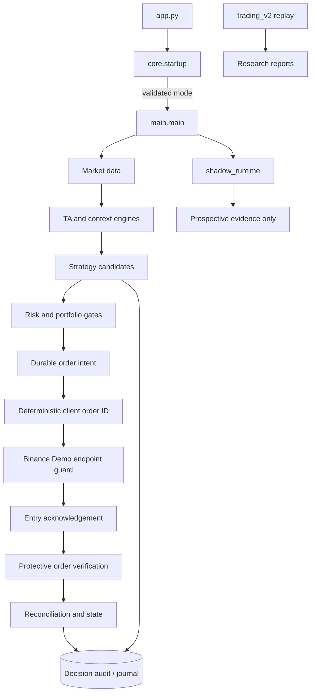
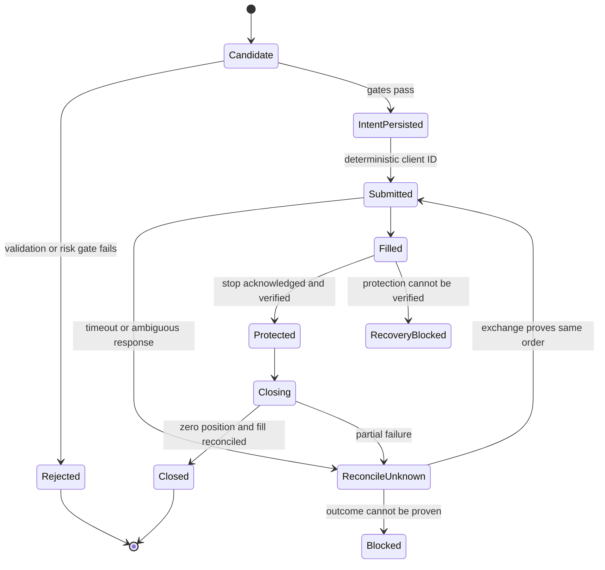

# Architecture

TradingBot5 prioritizes fail-closed execution, causal research, durable recovery, explicit authority, and auditable decisions. The current design preserves legacy interfaces while isolating newer execution and research paths.

## Runtime boundaries

`core.startup` imports no exchange, database, Telegram, or network client. It runs before client construction. Live mode is blocked unless the process environment contains the exact confirmation value. Demo execution separately requires testnet, Demo credentials, a guarded endpoint, and explicit enablement.

## Module responsibilities

- `core`: configuration, startup policy, redacted logging, exchange facade, and universe rules.
- `engines`: technical/market inputs and optional external analysis. AI or sentiment failure must not control protection or closing.
- `strategy` and `strategies`: signal, context, risk, confirmation, and management policies. Research-only modules must remain disconnected from order clients.
- `demo_execution`: Demo URL validation, signed HTTP client, durable SQLite store, executor, idempotency, and reconciliation.
- `shadow_runtime`: public-market observation, frozen policy identity, prospective state, and evidence storage without credentials or order methods.
- `trading_v2`: typed bars/plans, causal data access, indicators, replay, evaluation, and experimental strategies.
- `utils`: state persistence, single-writer lease, decision audits, journals, health, Telegram, and storage utilities.
- `webapp`: operational display/API; it does not supersede exchange reconciliation or startup authority.
- `main.py`: legacy composition root and thread orchestration. New business logic should live in focused modules with injected dependencies.

## Execution state

Reads may be retried with bounded backoff. A write retry is allowed only when an idempotency key and reconciliation make the outcome safe. Unknown exchange outcomes are never treated as clean failures.

## State and consistency

- Durable JSON/SQLite state is recorded around externally visible transitions.
- A single-writer lease prevents multiple account-managing runtimes from sharing a volume.
- Positions, regular orders, Algo orders, and local state are reconciled at startup.
- Corrupt primary state recovers only from a valid backup; otherwise writes are blocked.
- Decision and trade journals are append-oriented and redact known credentials.

## Research boundary

Research consumes timestamped bars and uses only information available at the decision instant. Entry fills, stops, targets, fees, slippage, funding, and capacity assumptions belong in the replay contract. Prospective shadow paths use public data and separate stores. See `RESEARCH_REPRODUCIBILITY.md`.

## Dependency direction and debt

Dependencies should point inward toward pure models and policy functions. Adapters receive stores/clients through arguments instead of importing runtime instances. `main.py`, `utils/telegram_bot.py`, `core/exchange.py`, and `utils/state_manager.py` remain oversized; configuration is still mostly import-time. Incremental extraction is preferred because the trade lifecycle is coupled and heavily regression-tested.
