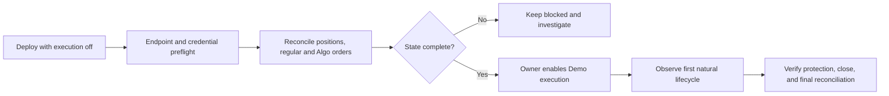

# Deployment

## Supported contract

The documented deployment is Binance USD-M Demo/Testnet. Live trading is retained only as a guarded legacy capability and is neither enabled nor certified by this repository. Deployments must keep secrets outside Git and use one account-managing process per account/data volume.

## Pre-deployment checklist

1. Review the exact commit and confirm CI results.
2. Keep `USE_TESTNET=true`, `TELEGRAM_PROPOSAL_DEMO_MODE=false`, and `DEMO_EXECUTION_ENABLED=false` initially.
3. Store separate Demo credentials and Telegram secrets in the platform secret manager.
4. Mount an empty, writable persistent volume at `/app/data`.
5. Back up any existing state; never reuse a production volume for testing.
6. Verify risk, leverage, position, daily-loss, and authorization settings.
7. Confirm no second runtime owns the same Demo account or volume.

## Docker Compose

```bash
docker compose build --pull
docker compose up
```

Compose loads `.env` and mounts `./data:/app/data`. Restrict filesystem and network access at the host level. Do not bake `.env` into the image; `.dockerignore` excludes it.

## Railway

`railway.json` uses the Dockerfile and starts `python -u app.py`. Configure a persistent volume at `/app/data`. Railway variables should contain secrets and non-secret runtime configuration; do not place them in deployment evidence.

## Enablement sequence



Never bypass an incomplete recovery to make the service healthy. A readiness endpoint is not proof that account state is consistent.

## Rollback and recovery

- Disable new Demo execution before changing versions.
- Preserve the data volume and export sanitized audit evidence.
- Roll back to a reviewed commit; do not restore code without compatible state schemas.
- Restart with execution disabled and reconcile before re-enabling.
- If a position is unprotected or ownership is ambiguous, stop automated mutation and follow the exchange/operator incident process.

## Observability and backups

Monitor process health, memory, disk, thread liveness, API status, reconciliation status, state writes, protection status, and decision audit continuity. Encrypt backups and restrict access because state/journals may contain account metadata even after credential redaction. Test restoration with Demo data.

## Branch protection preparation

After the feature branch is pushed, protect `main`, disallow force pushes/deletion, require pull requests and one approving review, require conversation resolution, and require the `Quality`, `Dependency Review`, and `Secret Scan` workflows. GitHub check names should be confirmed from the first PR before making them mandatory.
