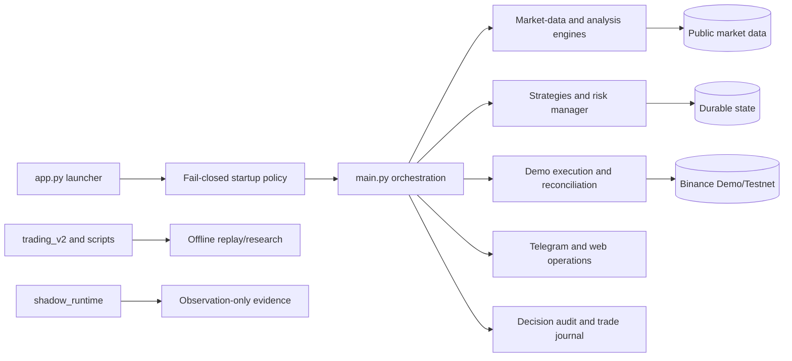

# TradingBot5

TradingBot5 is a Python algorithmic-trading research and Binance USD-M Demo execution platform. It combines deterministic technical analysis, modular strategies, risk controls, causal replay tools, prospective shadow evaluation, Telegram operations, and a web dashboard.

> **Financial risk:** This experimental software is not investment advice, does not promise profitability, and is not certified for unattended production trading. Leveraged derivatives can lose more than the initial margin. Use mocks or Binance Demo/Testnet while developing.

## Status

- CI is configured to test Python 3.10 and 3.11; the local final run used Python 3.10.
- Automated execution defaults off and testnet defaults on.
- Live mode requires a separate, exact operator confirmation before any exchange client is created.
- Tests use mocks, fixtures, and local stores; they do not place real orders.
- No project license has been granted yet. See [License status](#license-status).

## Purpose and capabilities

Trading systems can fail through stale data, duplicate orders, partial exchange responses, unsafe retries, state corruption, protection gaps, and research leakage. TradingBot5 addresses these risks with:

- Binance USD-M market data and guarded Demo/Testnet integration.
- Technical analysis, market regimes, candidate scoring, and modular strategies.
- Risk-based sizing, leverage/position caps, daily-loss controls, stops and targets.
- Durable order intents, deterministic client IDs, single-writer leases, reconciliation, and crash recovery.
- Causal replay, backtesting, walk-forward research, event studies, and prospective shadow evidence.
- Telegram authorization/operations, a Flask dashboard, and auditable decision/trade journals.
- Pytest, Ruff, Bandit, pip-audit, Gitleaks, dependency review, and Dependabot.

## Architecture



`app.py` is the deployment entry point. Its dependency-free startup policy runs before the legacy orchestration module creates clients or threads. Research and shadow components cannot authorize Demo orders. See [ARCHITECTURE.md](ARCHITECTURE.md).

| Path | Responsibility |
| --- | --- |
| `core/` | Configuration, startup policy, exchange facade, logging, universe selection |
| `engines/` | Technical, market-data, news, social, and optional AI analysis |
| `strategy/`, `strategies/` | Strategy, entry, risk, and management policies |
| `demo_execution/` | Demo endpoint guard, idempotency store, client, executor |
| `shadow_runtime/` | Public-data, observation-only prospective evaluation |
| `trading_v2/` | Causal models, indicators, replay, and evaluation |
| `utils/` | State, audits, monitoring, Telegram, health, and storage |
| `webapp/` | Operational dashboard and templates |
| `scripts/`, `tests/` | Research/operator tools and deterministic verification |

## Installation

```bash
git clone https://github.com/mrhokaalhoko-ops/tradingbot5.git
cd tradingbot5
python -m venv .venv
```

Activate `.venv` (`.venv\Scripts\activate` on Windows or `source .venv/bin/activate` on Linux/macOS), then:

```bash
python -m pip install --upgrade pip
python -m pip install -r requirements-dev.txt
copy .env.example .env  # Windows
# cp .env.example .env  # Linux/macOS
```

Keep `.env` local. It is ignored by Git.

## Configuration

`.env.example` is the canonical inventory. The most important controls are:

| Variable | Safe default | Purpose |
| --- | --- | --- |
| `USE_TESTNET` | `true` | Selects the test environment |
| `TELEGRAM_PROPOSAL_DEMO_MODE` | `false` | Enables the current strategy-to-Demo bridge |
| `DEMO_EXECUTION_ENABLED` | `false` | Separately grants Demo order authority |
| `BINANCE_DEMO_API_KEY`, `BINANCE_DEMO_API_SECRET` | empty | Demo-only credentials |
| `LIVE_TRADING_CONFIRMATION` | unset | Exact operator-controlled live opt-in; never set in source |
| `DATA_DIR` | platform-specific | Root for state, journals, logs, and SQLite data |
| `TELEGRAM_BOT_TOKEN`, `TELEGRAM_CHAT_ID` | empty | Telegram credentials and authorization |
| `RISK_PER_TRADE_PERCENT` | `0.25` | Configured loss budget before other caps |
| `ENTRY_MARGIN_PERCENT` | `1` | Target initial margin as percent of equity |
| `LEVERAGE` / `MAX_LEVERAGE` | `5` / `10` | Requested and hard-capped leverage |
| `MAX_OPEN_TRADES` / `HARD_MAX_OPEN_TRADES` | `10` / `10` | Runtime and hard position limits |
| `DAILY_LOSS_LIMIT_PERCENT` | `1.5` | Kill-switch threshold |

Credentials are loaded from environment variables and redacted by the logging layer. Never place them in source, CLI arguments, screenshots, issues, or fixtures.

## Binance Demo/Testnet setup

1. Create separate Binance Demo credentials with no relationship to production keys.
2. Keep `USE_TESTNET=true` and store credentials only in `.env` or a deployment secret store.
3. Start with both execution flags false.
4. Run tests and Demo preflight/reconciliation tools before enabling any Demo executor.
5. Confirm logs report `demo-fapi.binance.com`, `mainnet_order_route=false`, and complete reconciliation.

The guard accepts only HTTPS on an allowlisted Demo hostname and rejects mainnet hosts, URL paths, and nonstandard ports. Public mainnet market data may be used by explicit shadow/research collectors; this grants no account or order access.

## Running and testing

```bash
python -m pytest -q
python scripts/prove_shadow_no_execution.py
python scripts/prove_demo_b_r4_safety.py
python -u app.py  # external services require configuration
```

Quality/security checks:

```bash
python -m compileall -q app.py core demo_execution engines filters shadow_runtime strategies strategy trading_v2 utils webapp
ruff check .
ruff format --check app.py core/startup.py scripts/secret_scan.py tests/test_startup_policy.py tests/test_secret_scan.py
bandit -q -r core demo_execution shadow_runtime trading_v2 strategy -lll -iii
pip-audit -r requirements.txt
python scripts/secret_scan.py
```

See [TESTING.md](TESTING.md) for fixture, isolation, coverage, and warning rules.

## Strategies, risk, backtesting, and shadow testing

Modules cover hybrid signals, SMC/RSI, momentum continuation, dip/bottom-fishing experiments, regime filters, candidate scoring, and structural entry confirmation. Not every research strategy is connected to execution.

Runtime gates include contract metadata, fresh executable prices, risk/margin/portfolio caps, daily-loss state, duplicate/intention checks, and Demo authority. Filled entries require protective-order verification; failures remain auditable and recovery blocks unsafe continuation.

`backtest.py` supports the legacy path. `trading_v2/` and `scripts/replay_*.py` implement causal bars, costs, plans, chronological evaluation, and replay integrity. `shadow_runtime/` and Strategy V2 evidence modules collect prospective evidence without order authority. Follow [RESEARCH_REPRODUCIBILITY.md](RESEARCH_REPRODUCIBILITY.md); historical artifacts are not guarantees.

## Docker and deployment

```bash
docker compose build
docker compose up
```

Compose mounts `./data` at `/app/data`; Railway uses the Dockerfile and `app.py`. Use one account-owning writer per account/data volume. Back up state before upgrades and validate reconciliation after every restart. See [DEPLOYMENT.md](DEPLOYMENT.md).

## Security and troubleshooting

Report vulnerabilities privately as described in [SECURITY.md](SECURITY.md), never in a public issue. Rotate any possibly exposed credential; deleting it from the latest commit does not remove it from history or logs.

- **Live trading blocked:** restore `USE_TESTNET=true`; live operation is intentionally not automatic.
- **Demo endpoint rejected:** use `https://demo-fapi.binance.com` without a path or custom port.
- **Recovery blocked:** do not bypass it; reconcile positions, regular/Algo orders, intents, state, and audit records.
- **Second writer rejected:** stop the competing account-managing instance.
- **Tests use local state:** point `DATA_DIR` to a temporary directory and keep execution flags false.

## Known limitations

- `main.py`, `utils/telegram_bot.py`, `core/exchange.py`, and `utils/state_manager.py` remain large legacy modules.
- `Config` evaluates many environment values at import time; runtime concurrency is thread-based.
- Mocked tests cannot prove exchange availability, production correctness, or profitability.
- Backtest quality depends on data provenance, costs, and bias controls.
- The dashboard is operational tooling, not a hardened multi-tenant control plane.
- There is no independent production-reliability or external-adoption claim.

## Contributing, maintenance, and roadmap

Read [CONTRIBUTING.md](CONTRIBUTING.md), [ARCHITECTURE.md](ARCHITECTURE.md), and [SECURITY.md](SECURITY.md). Maintainer triage, review, versioning, dependencies, and releases are in [MAINTAINERS.md](MAINTAINERS.md).

Priorities are incremental orchestration/Telegram extraction, validated immutable settings, hermetic exchange-schema tests, a trustworthy coverage baseline, signed releases/SBOMs after licensing, and genuine prospective research/adoption evidence.

## License status

**No open-source license is currently granted.** Source availability alone does not grant permission to use, modify, or redistribute. [LICENSE_EVALUATION.md](LICENSE_EVALUATION.md) recommends Apache-2.0, subject to owner authorization and provenance review of imported code and assets. No `LICENSE` file will be added until that decision is complete.

The implementation and verification record for this readiness pass is in [FINAL_ENGINEERING_REPORT.md](FINAL_ENGINEERING_REPORT.md).
