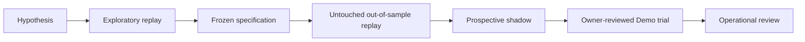

# Research Reproducibility Protocol

## Objective

TradingBot5 research must distinguish exploratory hypotheses, frozen rules, replay results, prospective shadow evidence, and Demo execution evidence. A profitable-looking backtest is not proof of a durable edge.

## Required experiment record

Every material experiment should record:

- immutable strategy/policy identifier and Git commit;
- hypothesis written before evaluation and the primary metric/gate;
- exact symbols, venue/market type, interval, UTC range, and inclusion rules;
- data provider, download time, source URL/API/archive, schema, time zone, and content hash;
- missing/duplicate/out-of-order bar handling and corporate/contract lifecycle assumptions;
- train, validation, and untouched test boundaries;
- fees, spread, slippage, funding, latency, leverage, liquidation, and capacity assumptions;
- fill model and whether signals use candle open/high/low/close known at that instant;
- random seeds, software/Python/dependency versions, command line, and output path;
- all attempted variants, including rejected and negative results.

Do not commit licensed market data or credentials. Store manifests and hashes when redistribution is not allowed.

## Time and causality rules

- Normalize event timestamps to UTC and retain source/open/close timestamps.
- A decision at time `t` may use only records available by `t`.
- Indicators must be shifted when their input candle is not closed at decision time.
- Fills cannot occur before the decision and must follow the declared intrabar ordering policy.
- Universe membership, ranking, and feature normalization must be computed prospectively.
- Perturbing future observations must not alter earlier signals, admissions, or fills.
- Feature fitting and parameter selection must use training data only.

## Splits and selection

Prefer chronological train/validation/test splits and walk-forward evaluation. The final test period stays untouched until the rule and thresholds are frozen. Reusing it for tuning converts it into validation and requires a new holdout.

Report the full candidate universe and rejected experiments. Control multiple comparisons when many strategies/parameters are tried. Survivorship must be addressed with point-in-time symbols/listing dates where possible; otherwise state the bias explicitly.

## Trading assumptions

Replay should model taker/maker fees as applicable, bid/ask or conservative spread, direction-aware slippage, funding for perpetual positions, tick/step/min-notional rules, latency, partial/unfilled orders, position capacity, and protection gaps. Zero-cost results may be diagnostic only and must not be promoted as realistic performance.

## Evaluation

Report sample counts, exposure, turnover, drawdown, distribution of returns/R-multiples, stability across time/symbols/regimes, and sensitivity to plausible costs. Avoid relying on a single aggregate return or win rate. Confidence intervals and bootstrap methods must preserve time dependence when used.

## Promotion workflow

Promotion requires predefined gates and a documented decision. Failure is a valid result. Never change risk limits or strategy parameters solely to improve presentation.

## Artifact naming

Use a stable experiment ID containing strategy, policy version, data cutoff, and commit prefix. Store a machine-readable manifest beside reports. Preserve negative artifacts that informed a decision and record supersession instead of rewriting history.

## Current limitations

Existing research scripts and reports predate this unified protocol. Their conclusions are not independently reproduced merely because code or JSON output exists. Each claim must be traced to data provenance, a frozen commit, an executable command, and verified causal/cost assumptions.
